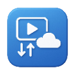

<div align="center">



# Media Bridge

**Detect, download, and record web video, right from your browser.**

HLS · MPEG-DASH · direct files · live streams, merged to MP4 entirely on your machine.

[](https://github.com/jvillegasd/media-bridge/releases)
[](LICENSE)
[](https://developer.chrome.com/docs/extensions/mv3/intro/)
[](https://www.typescriptlang.org/)
[](https://vite.dev/)
[](https://ffmpegwasm.netlify.app/)
[](https://github.com/jvillegasd/media-bridge/commits/main)

</div>

---

## Why Media Bridge?

Most video downloaders either send your data to a server or only handle plain `.mp4` links. Media Bridge does the whole job **locally**: it finds the stream, downloads the segments, and stitches them into a single MP4 using FFmpeg compiled to WebAssembly. Nothing leaves your browser unless you choose to upload it to your own cloud storage.

## Highlights

| | |
|---|---|
| **Auto-detection** | Finds videos on any page through DOM observation and network interception. |
| **Every common format** | HLS (`.m3u8`), MPEG-DASH (`.mpd`), and direct files (`.mp4`, `.webm`, ...). |
| **Live recording** | One-click REC for live HLS and DASH streams; stop any time and get an MP4. |
| **Private by design** | Muxing runs in-browser with FFmpeg.wasm. No third-party servers. |
| **Resilient** | Concurrent segment downloads, retries, AES-128 decryption, and partial save on cancel. |
| **Cloud upload** | Send finished files to Google Drive or any S3-compatible bucket. |
| **History** | Browse, re-download, or delete past downloads from the options page. |
| **Tunable** | Concurrency, retries, polling intervals, notifications, and more. |

## Supported Formats

| Format | Detection | VOD Download | Live Recording |
|--------|:---------:|:------------:|:--------------:|
| **HLS** (`.m3u8` master playlist) | ✅ | ✅ | ✅ |
| **M3U8** (`.m3u8` media playlist) | ✅ | ✅ | — |
| **DASH** (`.mpd` manifest) | ✅ | ✅ | ✅ |
| **Direct** (`.mp4`, `.webm`, etc.) | ✅ | ✅ | — |

## Installation

Media Bridge is loaded as an unpacked extension in any Chromium browser.

```bash
git clone https://github.com/jvillegasd/media-bridge.git
cd media-bridge
npm install
npm run build
```

Then in Chrome:

1. Open `chrome://extensions/`
2. Turn on **Developer mode** (top right)
3. Click **Load unpacked** and select the `dist` directory

## Usage

**Automatic detection.** Browse to a page with video. Detected videos appear in the extension popup's **Videos** tab; click **Download**.

**Manual URL.** Open the popup, go to the **Manifest** tab, paste an HLS, DASH, or direct URL, pick a quality, and click **Download**.

**Live streams.** When a live stream is detected a **REC** button appears. Click it to start recording and **STOP** when done; the segments collected so far are merged into an MP4.

## Cloud Upload

Upload is manual: open **Options → History → item menu → Upload to cloud**, pick the local file, and choose a provider.

<details>
<summary><strong>Google Drive setup</strong></summary>

Google Drive needs your own free OAuth credentials:

1. Go to [Google Cloud Console](https://console.cloud.google.com/) and create a project (or use an existing one).
2. Enable the **[Google Drive API](https://console.cloud.google.com/apis/library/drive.googleapis.com)**.
3. Go to **[Credentials](https://console.cloud.google.com/apis/credentials)** → **Create Credentials** → **OAuth client ID**.
4. Set the application type to **Web application**.
5. Under **Authorized redirect URIs**, add your extension's redirect URI, shown in **Options → Cloud Providers → Google Drive** next to the Client ID field. It looks like `https://<extension-id>.chromiumapp.org/`.
6. Copy the **Client ID** into the options page.
7. Click **Sign in with Google** to authorize.

> If you have not configured a consent screen yet, choose **External**, fill in the required fields, and add yourself as a test user. "Testing" mode needs no verification for personal use.

</details>

<details>
<summary><strong>S3 / S3-compatible storage setup</strong></summary>

1. In **Options → Cloud Providers → S3**, enter your bucket name, region, access key ID, and secret access key.
2. Your bucket needs a CORS policy that allows the extension origin. The options page generates the JSON and has a **Copy CORS Config** button; paste it into **S3 → Bucket → Permissions → CORS**.
3. Works with AWS S3, Cloudflare R2, Backblaze B2, Wasabi, MinIO, and other S3-compatible providers.

</details>

## Limitations

- **~2 GB output limit.** The muxer runs in browser memory; larger files fail during merging.
- **No DRM.** FairPlay and PlayReady protected streams cannot be downloaded.
- **CDN restrictions.** Some sites block extension requests via token auth or IP restrictions.
- **Browser memory.** Total concurrent segment data is bounded by available RAM.

## Troubleshooting

<details>
<summary><strong>Download fails</strong></summary>

- Verify the URL is accessible and not DRM-protected.
- Check the browser console for errors.
- Make sure the format is supported (HLS, DASH, or direct).

</details>

<details>
<summary><strong>FFmpeg merge fails</strong></summary>

- The file may exceed the ~2 GB limit; try a shorter clip or lower quality.
- Increase the FFmpeg timeout in **Options → Download Settings** if processing is slow.
- Check the offscreen document console for FFmpeg output.

</details>

<details>
<summary><strong>Videos are not detected</strong></summary>

- Some sites obfuscate requests or use proprietary players.
- Use the **Manifest** tab to paste the URL manually.
- Check the browser console for content script errors.

</details>

## Architecture & Internals

### Architecture

Media Bridge has five distinct execution contexts that communicate via `chrome.runtime.sendMessage`:

1. **Service Worker** (`src/service-worker.ts`): Central orchestrator. Routes messages, manages download lifecycle, keeps itself alive via heartbeat.
2. **Content Script** (`src/content.ts`): Runs on all pages. Detects videos via DOM observation and network interception. Proxies fetch requests through the service worker to bypass CORS.
3. **Offscreen Document** (`src/offscreen/`): Hidden page that runs FFmpeg.wasm. Reads segment data from IndexedDB, muxes into MP4, returns a blob URL.
4. **Popup** (`src/popup/`): Extension action UI — Videos tab (detected videos), Downloads tab (in-progress only), Manifest tab (manual URL + quality selector). A History button opens the options page directly on the history section.
5. **Options Page** (`src/options/`): Full settings UI with sidebar navigation — Download, History, Google Drive, S3, Recording, Notifications, and Advanced sections. All settings changes are confirmed via a bottom toast notification.

### Download Flow

**HLS / DASH VOD**:
1. Service worker creates a `DownloadManager`, which delegates to the format-specific handler
2. Handler parses the manifest and selects highest-bandwidth video + audio
3. Segments downloaded concurrently (up to `maxConcurrent`), stored as `Uint8Array` in IndexedDB
4. `OFFSCREEN_PROCESS_*` message triggers FFmpeg muxing in the offscreen document
5. FFmpeg returns a blob URL; service worker triggers `chrome.downloads.download()` → saves MP4

**Direct URLs**: `chrome.downloads.download()` used directly, no FFmpeg needed.

**Live Recording**: Handler polls the media playlist/MPD at the stream's native interval, collecting new segments. On stop (or stream end), collected chunks are merged into an MP4.

### State Persistence

| Store | Data | Reason |
|-------|------|--------|
| **IndexedDB** (`media-bridge` v3) | `downloads` (state + history), `chunks` (segments) | Survives restarts; supports large `ArrayBuffer` |
| **`chrome.storage.local`** | All config via `loadSettings()` / `AppSettings` | Simple K/V; 10 MB quota |

### Project Structure

```
src/
├── service-worker.ts          # Background service worker (central hub)
├── content.ts                 # Content script (IIFE format, video detection)
├── shared/
│   ├── messages.ts            # MessageType enum (all inter-context messages)
│   └── constants.ts           # Global defaults (concurrency, timeouts, etc.)
├── core/
│   ├── types/
│   │   └── index.ts           # VideoFormat, DownloadState, DownloadStage, Fragment, Level
│   ├── detection/
│   │   ├── detection-manager.ts
│   │   ├── thumbnail-utils.ts
│   │   ├── direct/            # Direct video detection
│   │   ├── hls/               # HLS detection
│   │   └── dash/              # DASH detection
│   ├── downloader/
│   │   ├── download-manager.ts
│   │   ├── base-playlist-handler.ts   # Shared segment download logic
│   │   ├── base-recording-handler.ts  # Shared live recording logic
│   │   ├── concurrent-workers.ts
│   │   ├── crypto-utils.ts    # AES-128 decryption
│   │   ├── header-rules.ts    # declarativeNetRequest header injection
│   │   ├── direct/            # Direct download handler
│   │   ├── hls/               # HLS download + recording handlers
│   │   ├── m3u8/              # M3U8 (media playlist) handler
│   │   └── dash/              # DASH download + recording handlers
│   ├── parsers/
│   │   ├── m3u8-parser.ts     # HLS playlist parsing (m3u8-parser)
│   │   ├── mpd-parser.ts      # DASH/MPD parsing (mpd-parser)
│   │   └── playlist-utils.ts  # Shared ParsedPlaylist/ParsedSegment types
│   ├── ffmpeg/
│   │   ├── ffmpeg-bridge.ts   # Unified FFmpeg request interface
│   │   ├── ffmpeg-singleton.ts
│   │   └── offscreen-manager.ts
│   ├── database/
│   │   ├── connection.ts      # IDB init (media-bridge v3)
│   │   ├── downloads.ts       # Download state CRUD
│   │   └── chunks.ts          # Segment chunk storage
│   ├── storage/
│   │   ├── chrome-storage.ts  # Raw chrome.storage.local access
│   │   └── settings.ts        # AppSettings interface + loadSettings() — always use this
│   ├── cloud/                 # Google Drive + S3 upload providers
│   │   ├── google-auth.ts     # OAuth via launchWebAuthFlow (user-provided client ID)
│   │   ├── google-drive.ts    # Resumable upload (chunked for files > 5 MB)
│   │   ├── s3-client.ts       # SigV4-signed PUT / multipart upload
│   │   └── upload-manager.ts  # Provider registry + routing
│   ├── metadata/
│   │   └── metadata-extractor.ts
│   └── utils/
│       ├── blob-utils.ts
│       ├── cancellation.ts
│       ├── crypto-utils.ts    # AES-128 decryption
│       ├── download-utils.ts
│       ├── drm-utils.ts       # DRM detection (FairPlay, PlayReady)
│       ├── errors.ts          # Custom error classes
│       ├── fetch-utils.ts     # CORS-aware fetch with retries
│       ├── file-utils.ts
│       ├── format-utils.ts
│       ├── id-utils.ts
│       ├── logger.ts
│       └── url-utils.ts
├── popup/                     # Popup UI (Videos / Downloads / Manifest tabs)
├── options/                   # Options page (Download, History, Drive, S3, Recording, Notifications, Advanced)
├── offscreen/                 # Offscreen document (FFmpeg.wasm processing)
└── types/
    └── mpd-parser.d.ts        # Type declarations for mpd-parser
```

### Permissions

- `storage` — Config persistence
- `downloads` — Save downloaded files
- `identity` — Google OAuth via `launchWebAuthFlow`
- `activeTab` / `scripting` — Content script injection
- `offscreen` — Offscreen document for FFmpeg.wasm
- `unlimitedStorage` — Large segment storage in IndexedDB
- `webRequest` — Intercept `.m3u8` / `.mpd` network requests
- `declarativeNetRequest` — Inject `Origin`/`Referer` headers
- `tabs` / `webNavigation` — Tab tracking for video detection
- Host permissions (`http://*/* https://*/*`) — Fetch video content

### Development

#### Build Commands

```bash
# Development build with watch mode
npm run dev

# Production build
npm run build

# TypeScript type checking only
npm run type-check
```

#### Key Dependencies

| Package | Purpose |
|---------|---------|
| `@ffmpeg/ffmpeg` `@ffmpeg/util` | FFmpeg.wasm segment muxing (≤ ~2 GB output) |
| `m3u8-parser` | HLS playlist parsing |
| `mpd-parser` | DASH/MPD manifest parsing |
| `idb` | IndexedDB wrapper |
| `uuid` | Unique download IDs |
| `url-toolkit` | URL resolution for relative segment paths |

## License

Released under the [MIT License](LICENSE).
